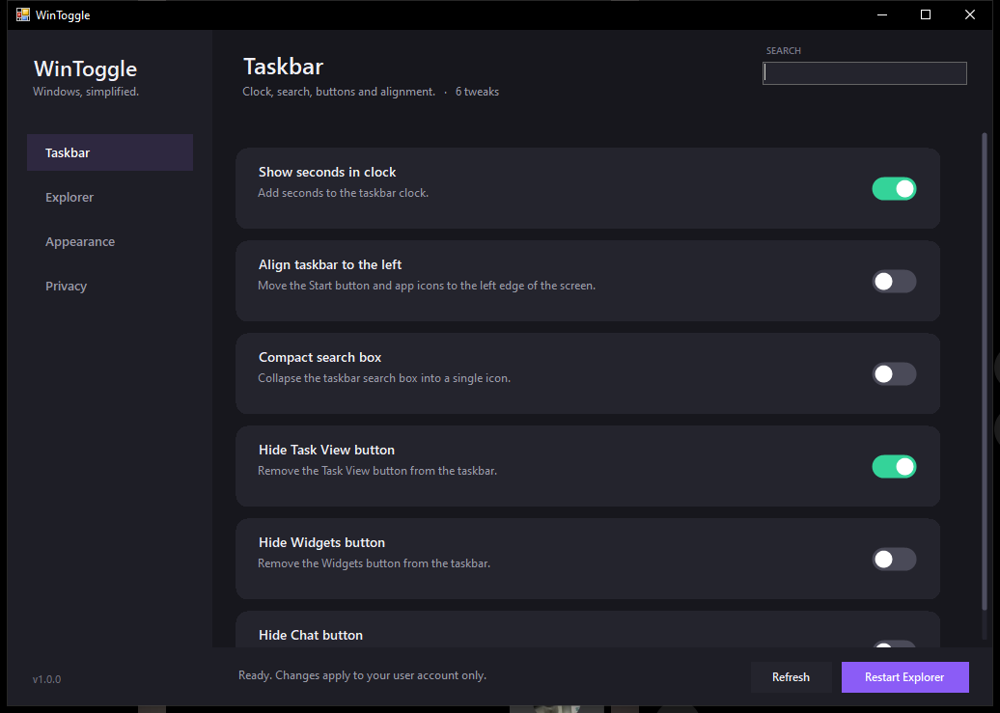

# WinToggle

**Windows, simplified.** A small native Windows app that flips common system tweaks with real toggle switches — no regedit, no admin rights, no background services.



## Install

Run **`WinToggleSetup.exe`** and follow the wizard.

- Installs to `%LOCALAPPDATA%\WinToggle` (per-user, no UAC prompt)
- Optional desktop and Start menu shortcuts
- Registers under **Settings › Apps › Installed apps** so you can uninstall normally
- Keeps a copy of the setup in the install folder for clean removal

Prefer portable? Just run `WinToggle.exe`. It has no dependencies and writes nothing outside the registry.

> The executables are unsigned, so Windows SmartScreen may show a warning the first time. Choose **More info › Run anyway**.

## What it can change

### Taskbar
- Show seconds in the clock
- Align the taskbar to the left (Windows 11)
- Collapse search into a single icon
- Hide the Task View button
- Hide the Widgets button
- Hide the Chat / Meet Now button

### Explorer
- Show hidden files
- Show file extensions
- Show protected operating-system files
- Open Explorer to This PC instead of Quick Access
- Restore the classic (Windows 10) right-click menu on Windows 11

### Appearance
- Dark mode for apps
- Dark mode for Windows
- Transparency effects
- Window animations
- Accent color on title bars
- Hide desktop icons

### Privacy
- Disable Bing results in Start search
- Turn off suggested content in Settings
- Turn off Windows tips and suggestions
- Turn off promotional banners in File Explorer

Every switch reflects the **current** state of your system when the app opens. Flip it back to undo.

## How it works

WinToggle reads and writes values under `HKEY_CURRENT_USER` — the same keys you would edit by hand. Nothing is installed as a service or driver, and no administrator rights are required. A **Restart Explorer** button is included for changes that only apply after the shell reloads; a few tweaks (like dark mode) may need a sign-out.

## Uninstall

- **Settings › Apps › Installed apps › WinToggle › Uninstall**, or
- run `%LOCALAPPDATA%\WinToggle\WinToggleSetup.exe --uninstall`, or
- silent: `WinToggleSetup.exe --uninstall --silent`

Uninstalling removes the app, both shortcuts and the registry entry. Tweaks you enabled stay as they are — flip them back first if you want a clean slate.

## Build from source

Requires Windows with .NET Framework 4.x (present on every modern Windows install).

```powershell
.\build.ps1
```

This produces:

| File | Purpose |
|---|---|
| `WinToggle.exe` | The app (portable) |
| `WinToggleSetup.exe` | Install wizard with the app embedded |
| `app.ico` | Generated by `generate-icon.ps1` |

Source layout:

```
WinToggle.cs        App: settings model, registry engine, UI, toggles
Setup.cs            Install wizard + install/uninstall engine
app.manifest        DPI awareness + supported OS
generate-icon.ps1   Builds the multi-resolution icon
build.ps1           Compiles both executables with csc.exe
selftest.cs         Registry engine tests (compile against WinToggle.exe)
```

Installer flags:

```
WinToggleSetup.exe --silent                 install with defaults
WinToggleSetup.exe --silent --dir "C:\path" install to a custom folder
WinToggleSetup.exe --uninstall              interactive uninstall
WinToggleSetup.exe --uninstall --silent     silent uninstall
```

## Notes

- Built for Windows 10 and Windows 11. Some tweaks are version-specific (for example, taskbar alignment only affects Windows 11).
- WinToggle only touches your own user profile. It cannot break a machine for other users and does not require elevation.
- Use at your own risk — these are the same registry values power users edit manually, but you are still editing the registry.
